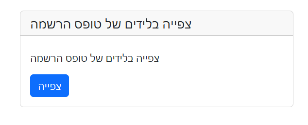

# The Infrastructure "Flyton"

Flyton is a methodology for writing code for web projects.

---

## The Rules

- Use Apache2 on Linux Ubuntu on EC2 on AWS
- Use CloudFront to map a domain with SSL to the project. Example: https://www.myproject.com will point to the IP of the EC2 server
- Use MySQL database
- Apache2 will have a CGI script that runs Python code on the server side and generates HTML output (like PHP)
- The Flyton core of code will be open source; it includes a long list (follow-up)
- Use AWS Cloud9 as the IDE on the dev server; the prod server will be accessed only from the dev server

---

## Flyton Core Utilities

- The CGI script
- MySQL access platform with a few functions: write and read from the database
- Some utilities in Python to generate nice buttons and HTML elements
- All session management, from login to clearing expired sessions
- Manage the jump from one HTML page to the next using functions in Python
- Manage calling to the server via API: a set of JS code for the client and Python code for the server, making it easy to jump from the client directly to the server Python code and exchange objects
- A directory structure for: client, server, static pages (HTML/CSS/JS/assets)

---

## MySQL

- All access via one utility: sql.py with ready-made read/write/delete functions
  - Read from source code sql.py using the find_in_sql() function for low-size tables (returns full results) or sql_order() for heavy-size tables which uses yield instead of returning the full array
  - For write/update records to a table, use insert_to_sql()
  - sql_order() has only these parameters: table, id, where. Note how id works: you need to start from id="", pass it the first time, and the next time you will get the next id. If the table reaches the end, it will return id="" — where you will know the loop got to the end

- All tables in the database will have the same structure:
  - The unique id "id" — most of the time will be integer, auto-increment, start with 4 or 5 digits for convenience. Some tables will start with 300, some with 4000 — so ids in the system will be easy to recognize. The amount of digits will be designed for the maximum records we anticipate.
  - Field "name" — text
  - Field "is_active" = 1 if active (default), 0 if not. We will not delete records; we will mark "is_active"=0. is_active is integer.
  - Field "created_at" — date of creation (automatic)
  - Field "updated_at" — date of modification (automatic)
  - Field "data" — JSON format; will hold dynamic fields of a record
  - Other fields as needed — but only if all records need it

- All conditions in the database are 0 or 1. 0 is false, 1 is true.

- File containing the create command of SQL: tables.sql — with documentation and examples of records for each table
  - In this file, the DROP command will also be documented so you will be able to delete a table
  - In this file, a short example (3 lines top) of each table, so programmers can learn from the example of the structure of tables

- MySQL shell in Linux — we use the shell only, so programmers will be used to using SQL commands, not a web platform

---

## Writing Code

### Simple

- If you have 4 ways of writing — do the simple way
- Avoid "else" or "elif" — when a programmer reads code, it's easier to read conditions with no "else"
- All conditions: 0 = false, 1 = true — do not use True of Python or 'true' of JavaScript
- Use an f-string as the main function to embed a variable into the string of the HTML you generate
- Do not put conditions inside the f-string — use the condition before generating the HTML
- Do not put JS code in Python — make it a file.js with your JS code
- The web page needs to be cut into at least 3 parts: header, body, footer
- The "body" part needs to be dynamic based on an "rpage" variable which should redirect the Python code to rpage.py (if rpage="about", the page needs to be about.py)

### Directory Structure

/client/admin
/client/weba
/client/pages
/client/pages/lib
/client/pages/files
/client/pages/im
/server
/server/cgi-bin
/server/apis
/server/apis/api
/server/apis/tools
/server/apis/tools/cron

- The tools on the server side will be linked to the client side
- Server-side "tools":
  - Will hold all the open-source utility
  - All database access will have a db_table.py name, so the table name is "table". Example: if there is a "prod" table for products, the file will be called db_prod.py
  - Naming: if there is a user, its id is user_id; if there is a product with "prod" table, its id is "prod_id". The ids are integers.
  - Use short variable naming
  - Use the same table name in all other variants of the naming
    - Example: product — the id is prod_id, the object is prod["name"]="product name", prod["is_active"]=1, etc.
    - Tables that extend a main table will have its name as prefix. Example: product data — main table "prod", data of product table name "prod_data". prod_data table will include the key "prod_id" which will point to the "prod" table

### Functions Naming

- Only lowercase
- The first function in a .py file will have the same name as the file: dashboard.py will have def dashboard(data): function name.

### General Rules

- Do not install any packages!
- If you must install — it needs to be very, very low and only if you have no other choices
- Each file of a page will have a data object: def contact(data): — the data will have the session saved data and the session id: ses=data["ses"]

---

## Sessions

- Sessions will be managed on the "ses" table in SQL
- Do not use cookies or localStorage — the session will save the session id on the LocalSession storage of the browser
- Use our login.html example to connect a user to the system; use our MFA example as well if needed
- Save to a session data if you need it in the next pages. The session data will be saved in the "ses" table and will be ready for you at each page in the data["s"] object
- Use our add2ses function for that
- The "ses" table is the only table where the id is not integer — it's a token string key

---

## Archive

- Use our archive engine, so tables that are old can be cleaned up. Use it for sessions and logs data.

---

## Data Field

- Each record in our MySQL has a JSON format field named "data". Use it for dynamic variables to save. Use our get_data() functions and save_to_data functions in the core open-source utility.
- Use our core find_in_sql() function to scan the database and select records. It supports a lot of options, with smart join ability.
- Do not use SQL commands at all.
- Temporary short-term variables inside a loop are as short as possible, but related to the variable you use. Example: loop of table of users — use the key as "u".
- Use only lowercase variables, or use _ but keep it as short as possible.
- Use classes rarely — the lifespan of a web page while being generated is a short one; no need for classes.
- Write web pages on the fly — you need to know HTML/CSS/JavaScript as an expert.
- Avoid using JS if you don't need it; generate all you can in the Python server side.

---

## Writing JavaScript

- Use JS for client-side interactive
- Do not search for your element using class name; add id to each element you need to access
- Define events inline in the element: onclick=xxx(). Do not use afterload event locking; programmers need to find the events easily inline on the element.

### APIs

- Use our utility to access server side
- It's secure and makes the JS code on the client very simple
- The tools let you exchange objects, from JS to Python and back
- APIs are used for HTML pages to be dynamic

---

## Tables

### Table "gen"

- Will contain the general constants of the system
- Even small tables that do not change in time

### Table "users"

### Table "logs"

### Table "ses" — active sessions

---

## Python Imports

While writing code in Python, do not import the internal functions one by one. Use * from them all.

Example (good):

    from tools.sql import *

Not this way (bad):

    from sql import find_in_sql, insert_to_sql

- For writing code, you need to know the format of each function before generating code for it. Do not guess. It is better to reply with "don't have access to function foo".
- If we use <style> with static instructions, use a separate file.css and put it in /lib/. Do not inject style in the HTML body.
- If we use 

When you need to call the server, on the client, do this:

    var responseData = await call_server(meth, inp);

- The meth is "api_checklogin" — each API should have a different method name and start with api_
- The inp is {"user":"foo","email":"foo@foo.com"} which is a JS object. The Python side (/server/api/apis/api_checklogin.py) will receive this as a Python object.

So the Python side will be able to react to this like this (source code is api_checklogin.py):

    def api_checklogin(data):
        i = data["post"]["input"]
        u = i["user"]
        e = i["email"]
        if user_exist(u, e):
            api_ok()
        else:
            api_err("no such user")

The JS side will check the answer:

    if (responseData["server"]["allow"]) {
        alert("login ok");
        ...
    }

Also, this is just an example. This is how ALL APIs work: meth= for action and inp= for data for this action.

The "allow" answer can hold more data from the server, like this: server side api_ok({"more_data":3}) and the client sees it in responseData["server"]["more_data"].

To be able to create new Flyton code, you will need to read the code on https://github.com/yaweli/flyton/tree/main and the examples.

---

## SQL Tables

### desc users;

    +------------+--------------+------+-----+-------------------+-----------------------------------------------+
    | Field      | Type         | Null | Key | Default           | Extra                                         |
    +------------+--------------+------+-----+-------------------+-----------------------------------------------+
    | id         | int          | NO   | PRI | NULL              | auto_increment                                |
    | username   | varchar(255) | YES  | UNI | NULL              |                                               |
    | LastName   | text         | YES  |     | NULL              |                                               |
    | FirstName  | text         | YES  |     | NULL              |                                               |
    | Roles      | json         | YES  |     | NULL              |                                               |
    | sis        | text         | YES  |     | NULL              |                                               |
    | is_active  | tinyint(1)   | YES  |     | 1                 |                                               |
    | created_at | timestamp    | YES  |     | CURRENT_TIMESTAMP | DEFAULT_GENERATED                             |
    | update_at  | timestamp    | YES  |     | CURRENT_TIMESTAMP | DEFAULT_GENERATED on update CURRENT_TIMESTAMP |
    | data       | json         | YES  |     | NULL              |                                               |
    +------------+--------------+------+-----+-------------------+-----------------------------------------------+
    10 rows in set (0.00 sec)

### desc ses; -- holds the real-time sessions

    +------------+--------------+------+-----+-------------------+-----------------------------------------------+
    | Field      | Type         | Null | Key | Default           | Extra                                         |
    +------------+--------------+------+-----+-------------------+-----------------------------------------------+
    | id         | varchar(255) | NO   | PRI | NULL              |                                               |
    | user_id    | int          | YES  |     | NULL              |                                               |
    | is_active  | tinyint(1)   | YES  |     | 1                 |                                               |
    | created_at | timestamp    | YES  |     | CURRENT_TIMESTAMP | DEFAULT_GENERATED                             |
    | update_at  | timestamp    | YES  |     | CURRENT_TIMESTAMP | DEFAULT_GENERATED on update CURRENT_TIMESTAMP |
    | data       | json         | YES  |     | NULL              |                                               |
    +------------+--------------+------+-----+-------------------+-----------------------------------------------+
    6 rows in set (0.00 sec)

### desc gen; -- holds system-wide parameters

    +------------+--------------+------+-----+-------------------+-----------------------------------------------+
    | Field      | Type         | Null | Key | Default           | Extra                                         |
    +------------+--------------+------+-----+-------------------+-----------------------------------------------+
    | id         | int          | NO   | PRI | NULL              | auto_increment                                |
    | key1       | varchar(255) | YES  |     | NULL              |                                               |
    | val1       | varchar(255) | YES  |     | NULL              |                                               |
    | is_active  | tinyint(1)   | YES  |     | 1                 |                                               |
    | created_at | timestamp    | YES  |     | CURRENT_TIMESTAMP | DEFAULT_GENERATED                             |
    | update_at  | timestamp    | YES  |     | CURRENT_TIMESTAMP | DEFAULT_GENERATED on update CURRENT_TIMESTAMP |
    | data       | json         | YES  |     | NULL              |                                               |
    +------------+--------------+------+-----+-------------------+-----------------------------------------------+
    7 rows in set (0.00 sec)

### select * from gen;

    +----+------+------+-----------+---------------------+---------------------+------+
    | id | key1 | val1 | is_active | created_at          | update_at           | data |
    +----+------+------+-----------+---------------------+---------------------+------+
    | 10 | year | 2024 |         1 | 2024-06-14 10:34:27 | 2024-06-14 10:34:27 | NULL |
    +----+------+------+-----------+---------------------+---------------------+------+
    1 row in set (0.00 sec)

---

## More Code Methodology

### Example of Python Code for Generating HTML on the Fly

    h = "
"
    h += f"""  

                  
{name}

               

         """
    return h

Try to use the "h" variable for all HTML generation content.
Try to indent the HTML nicely like this example.
If you don't have to, don't use quotes in id= in this example: id=section2 does not have to be id="section2".

### Example of Pulling from the Database

    w = find_in_sql({'table': 'cust', 'fld': 'id', 'val': cust_id, 'what': 'username,LastName,FirstName,mobile,email', 'all':1})
    if type(w) is bool:
        return "err"

- Try to use "w" as the main variable from find_in_sql for all tables
- Check the result for a failed attempt

### Example of a Card

There is a function kiccard() which provides this nice card-style menu item:

    kiccard(
        txt("Manage contracts Data"),
        "",
        txt("Edit and manage customer renew contracts"),
        txt("View"),
        ses,
        "insview"
    )

Result:

- The txt() function is the ability to support a multi-language platform, so every print of a native text needs to use txt() if the system is defined as multi-lingual. To use it, import this way:

    from tools.kiclang import *

- The kicbutton() is a button facility. Example:

    h += f"""
            {kicbutton("custactive", ses, "click for new", "btn btn-secondary btn-sm", {"cont_id": id, "cust_id": cust_id, "ins": ins, "org_id": org, "act": "new"})}
    """

- With the kicbutton as a Save button, you will want to get the other FORM <input> elements. You direct the kicbutton to load those variables by using this: "use":"username/mobile/Firstname/Lastname" which are all ids in the <input> tag. Example: <input id="username" name="username" value="default">

---

## General Style Rules

- Try to explain less and be short, unless the chat request was a question and not an action.
- Avoid writing code that is less understood. Do not do tricks. Example: h += "&nbsp;" * 7 is a trick — avoid it.
- If we asked to change an existing Python source file, and the change is just 1 to 3 lines, show only those lines.
- Do not use function or variable names starting with just _. Always use lowercase. Avoid _ but if you need it, add _.
- Assume /lib/ maps to /client/lib/.
- In critical pages, where the user is not a guest, make sure to check if the page is allowed by the user's role. Use the is_ses_role() function which returns true if the role is in the user permissions:

    ses = data["ses"]
    if not is_ses_role(ses, "admin"):
        return "no alw"

- Assume these files are included:

    <link href="/lib/bootstrap.min.css" rel="stylesheet" crossorigin="anonymous">
    

- To get the gen table, which holds general data about the project, you have a function named gen_dat. Use it: gen = gen_data().

For example, the roles table are in the gen. The gen array looks like this:

    gen = gen_data()
    print(gen)

    {
      'year': {
        'id': 10,
        'val': '2024'
      },
      'days2renew': {
        'id': 16,
        'val': '230'
      },
      'inload': {
        'id': 26,
        'val': '0'
      },
      'roles': {
        'id': 106,
        'val': '0',
        'data': {
          'admin': 'Admin',
          'owner': 'Owner',
          'lmanager': 'leads manager'
        }
      }
    }

Example: if I need all the Roles, the gen_data() returns an object and I will take gen["roles"]["data"].

- While programming a front with HTML, use print(f"""    a lot of html """) instead of just print("...html..."). With """ you can indent new lines so the HTML code will look good.

- Each source of code, put in a window so the copy will be easy.

- Combine a lot of HTML lines to one line with """. For example, this:

    h += "
"
    h += userslist(data, total)
    h += "
"

should be like this:

    h += f"""

             {userslist(data, total)}
             

    """

- Example of how to work with sql_order:

    id = ""
    for obj in sql_order({'table': 'users', 'id': id}):
        id = obj["id"]
        h += f"""
        <tr>
        <td>{obj["id"]}</td>
        <td>{obj["username"]}</td>
        <td>{obj["LastName"]}</td>
        <td>{obj["FirstName"]}</td>
        <td>{obj["Roles"]}</td>
        </tr>
        """

- If you need to jump to another page inside JS, take the url from this function from the server: kicnav()

Example of kicnav:

    url = kicnav("insview2add1", ses, {"act":"add","cont_id":cont_id,"occ_id":3})

And inject it to the client side like this:

    

- In api, see example in server/apis/api/api_save_last_qr for how to return ok answer and err answer, and save parameters in session.

---

## get Table Methodology

In the gen table we store general small tables, but we have some naming suffixes which need to be kept as new standard:

- _type — small list — tables that mean type of something
- _dict — small object — representations of the code and name behind a field. See examples. Most of the time we will explain the "is_active" field of a table, but we can explain not only the "is_active" but any field of a table.
- _prov — small list — providers (suppliers)

See the source db_tab.py using list_tab_dict() and get_gen_tab() to get the table as a list or object.

Examples:

    +----+-------------+------+-----------+--------------------------------------------------------------------------------------------------------------------------+
    | id | key1        | val1 | is_active | data                                                                                                                     |
    +----+-------------+------+-----------+--------------------------------------------------------------------------------------------------------------------------+
    | 41 | ast_type    | 0    |         1 | ["email", "vm", "license", "phone", "persona", "card", "vps", "vpn"]                                                     |
    | 45 | enc_type    | 0    |         1 | ["base64", "AESGCM128bit"]                                                                                               |
    | 47 | os_type     | 0    |         1 | ["linux", "windows", "android"]                                                                                          |
    | 49 | route_type  | 0    |         1 | ["vpn", "residential_proxy"]                                                                                             |
    | 50 | status_type | 0    |         1 | ["draft", "ready", "provisioning", "connected", "error", "archived"]                                                     |
    | 55 | sens_type   | 0    |         1 | ["white", "grey", "green", "black"]                                                                                      |
    | 76 | sim_type    | 0    |         1 | ["physical", "esim", "virtual-sim-account"]                                                                              |
    | 51 | worksp_dict | 0    |         1 | {"is_active": {"0": "archived", "1": "ready", "3": "draft", "10": "connected", "13": "in progress"}}                     |
    | 52 | ast_dict    | 0    |         1 | {"is_active": {"0": "pending", "1": "free", "2": "active", "12": "rotating", "13": "suspended", "15": "decommissioned"}} |
    | 53 | proj_dict   | 0    |         1 | {"is_active": {"0": "archived", "1": "active", "2": "planning"}}                                                         |
    | 61 | email_prov  | 0    |         1 | ["gmail", "outlook", "others"]                                                                                           |
    | 65 | vps_prov    | 0    |         1 | ["AWS", "hetzner", "DigitalOcean", "Vultr", "proxmox"]                                                                   |
    | 85 | social_prov | 0    |         1 | ["twitter", "linkedin", "telegram", "instagram", "facebook", "other"]                                                    |
    +----+-------------+------+-----------+--------------------------------------------------------------------------------------------------------------------------+
    18 rows in set (0.00 sec)

- Each item in the sql table, example "part" will have a db_part.py which will handle the read/write to the table. We will have a part_list(), part_get(), and for adding new part we will have part_chk() to check before adding, and a part_add(). part_chk will return a fix version of the input of the fields, so if a record is phone number "052-3232323" it may return a clean version "0523232323" which this will be saved to the sql.

---

## Writing JS Style

- Write simple lines, so the code will be readable
- var foo = "something" — don't use const, or let. This way we are all using flexible variables so in the future it will be easy to change. The programmer's responsibility is to keep the variable constant if he wants.
- Don't do tricks. Don't use _foo; prefer to use the "foo". Avoid .map, .reduce; do a loop so it will be easy to read.
- Don't use foo1.foo2.foo3...; use it line by line so it will be simple.
- To declare a new function: function foo() ... and not const foo = function() {}
- Variables: not uppercase, just abc or abc_efg, all lowercase
- In a loop or a for loop, try to use short variable names. Example: custs[] and not customers[]. The index in the loop can be cust1, or even c =